# لوحة الاتصال البصرية E (Contact Sheet E — Mobile Production Verification)

> **البيئة المختبرة**: Google Chrome (Chromium) بدقة 360x780 (Android DPR 2) و 390x844 (iOS) و 430x932.
> **طريقة التشغيل**: خادم الإنتاج الكامل (`vite preview` على مجلد `dist/`) بالمسار الأساسي (`/maganis-app/`).

## قائمة اللقطات الميدانية الموثقة

| الرقم | المعاينة                                                            | الوصف والشاشة                                    | الأبعاد والنمط |
| ----- | ------------------------------------------------------------------- | ------------------------------------------------ | -------------- |
| 01    | 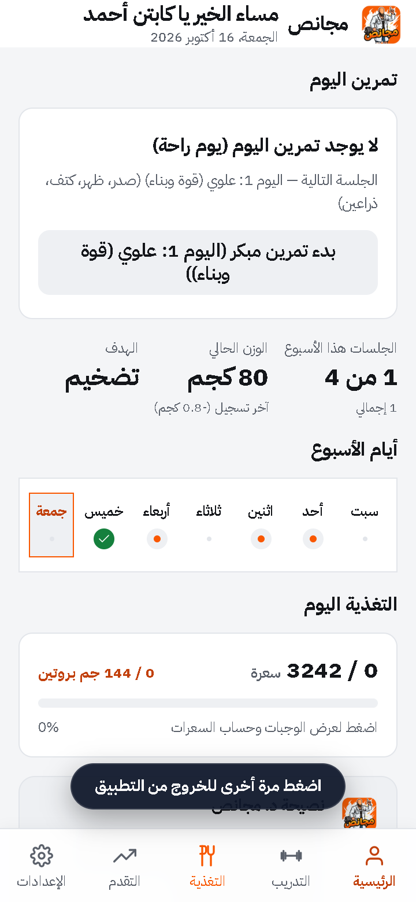                              | لوحة القيادة الرئيسية (Dashboard)                | 360x780 (فاتح) |
| 02    | 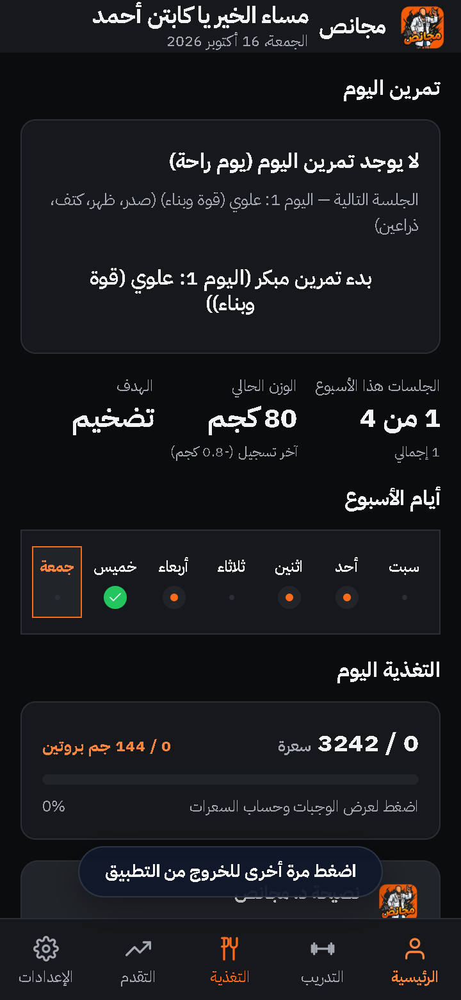                                | لوحة القيادة الرئيسية (Dashboard)                | 360x780 (داكن) |
| 03    | 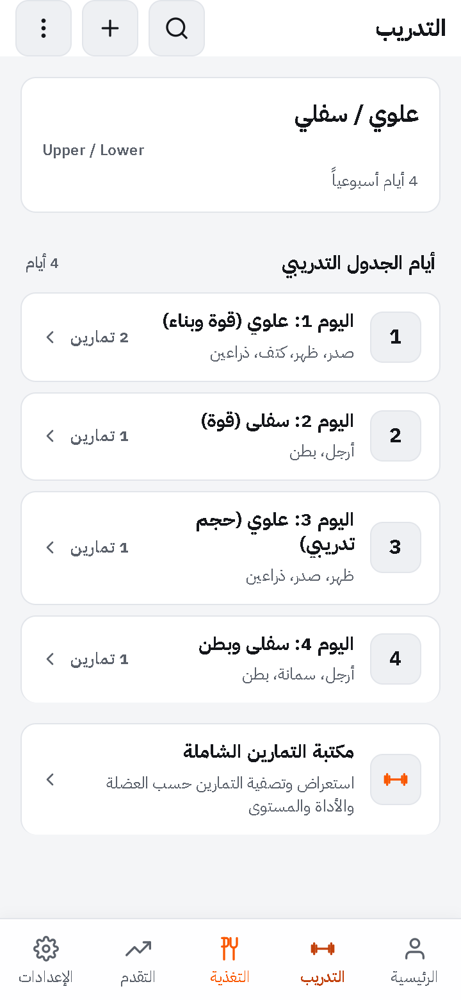               | خطة التدريب الأسبوعية والأيام 1-5                | 360x780 (فاتح) |
| 04    | 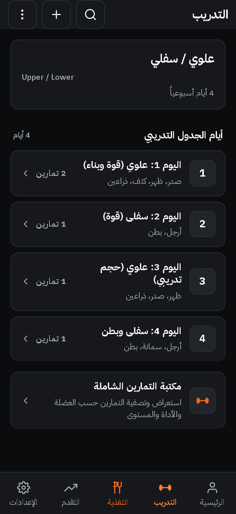                 | خطة التدريب الأسبوعية وشريط التوب بار            | 360x780 (داكن) |
| 05    | 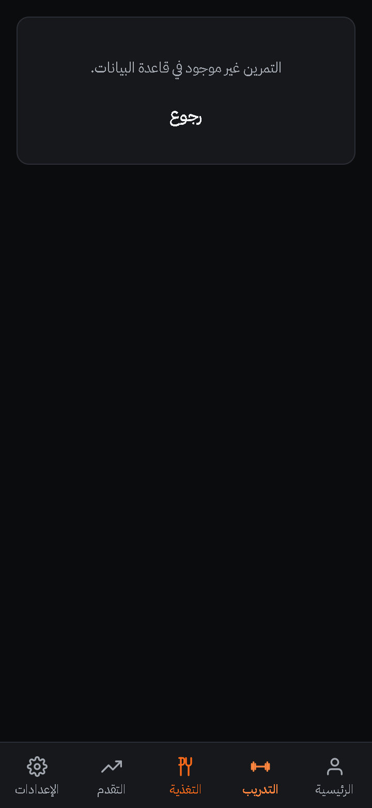         | صفحة التمرين والميديا المتجاوبة والألسنة الثابتة | 360x780 (داكن) |
| 06    | 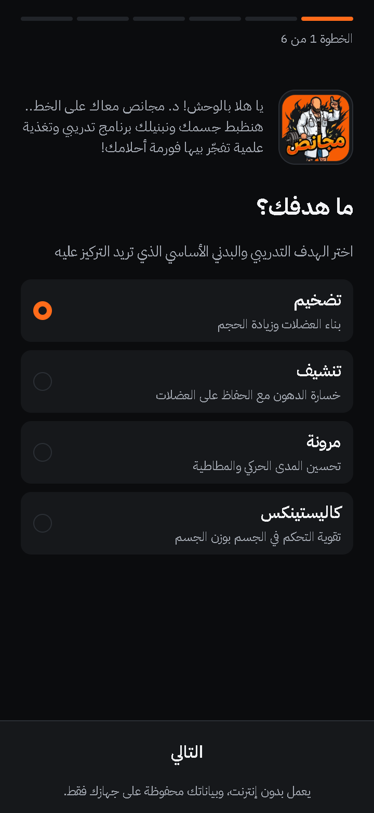           | أطلس العضلات التشريحي وتصنيف الرؤوس              | 360x780 (داكن) |
| 07    |  | إرشادات الأداء والتكنيك الحركي والتنفس           | 360x780 (داكن) |
| 08    |             | وصفة الجدول والراحة وصياغة المدى اللغوي          | 360x780 (داكن) |
| 09    | 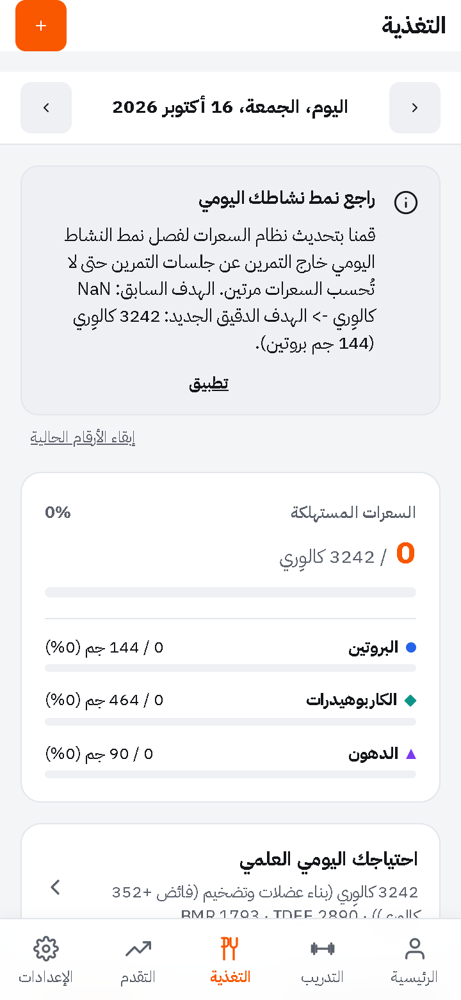        | قسم التغذية والألوان الباردة الثلاثة للماكروز    | 360x780 (فاتح) |
| 10    |                   | نافذة دليل الماكروز العلمي وقواعد الطاقة         | 360x780 (فاتح) |
| 11    |                       | نافذة تصميم الوجبة والتذييل الثابت للأزرار       | 360x780 (فاتح) |
| 12    | 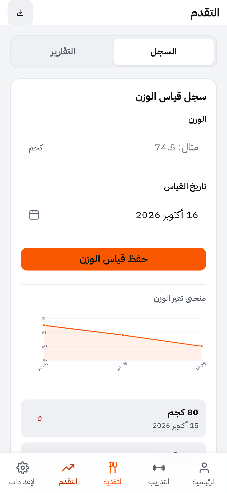                | سجل التقدم وشبكة التقويم 7 أعمدة بدون انضغاط     | 360x780 (فاتح) |
| 13    | 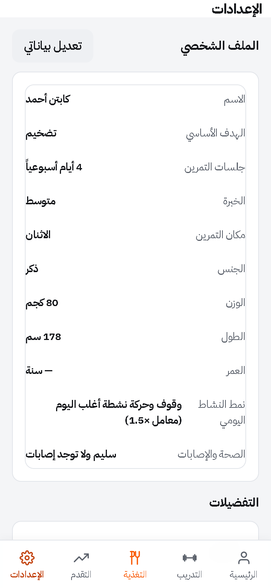                        | الإعدادات والمزامنة الحية بدون تشوه النصوص       | 360x780 (فاتح) |
| 14    | 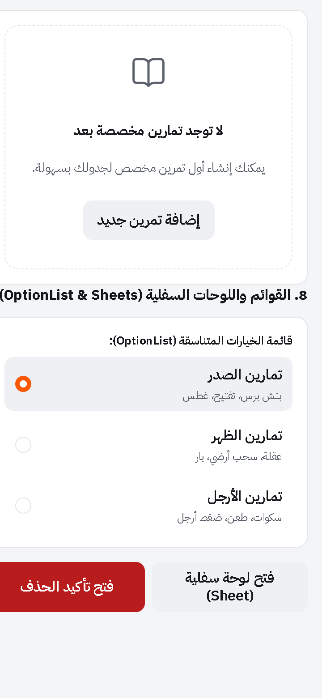                  | مكتبة مكونات التصميم والأزرار والحقول            | 360x780 (فاتح) |
| 15    | 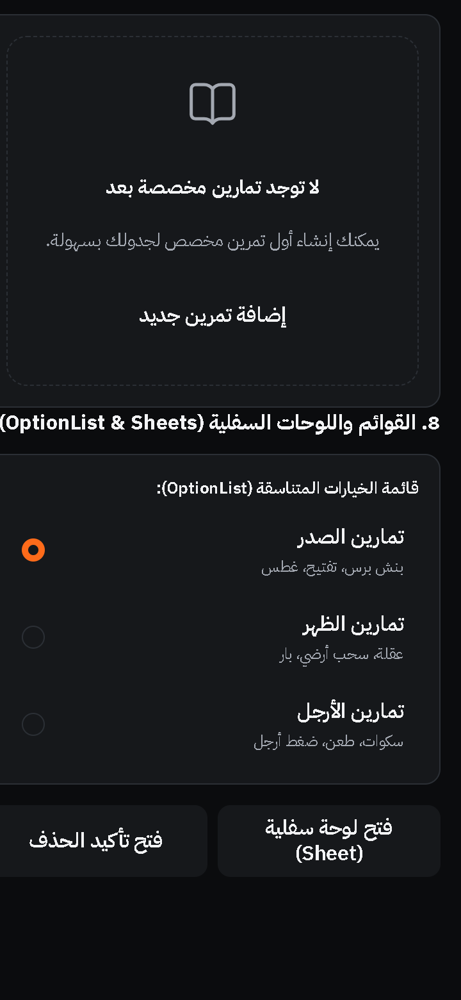                    | مكتبة مكونات التصميم ومؤشرات التباين             | 360x780 (داكن) |
| 16    | 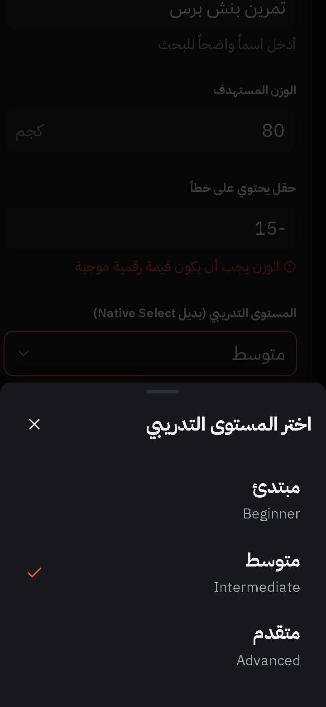           | اختبار فتح نافذة Select السفلية وخيارات 44px     | 360x780 (فاتح) |
| 17    | 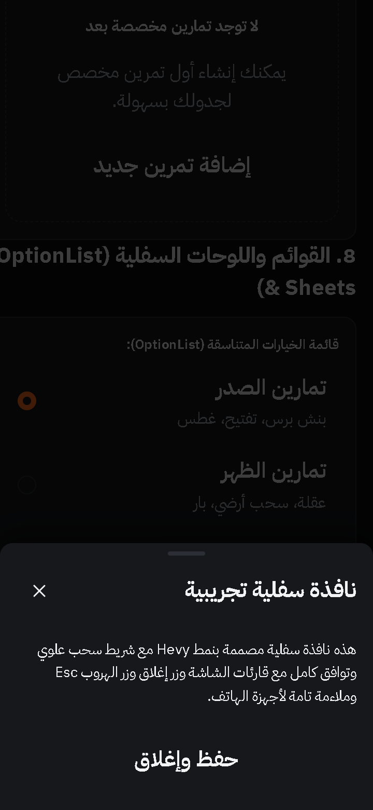             | اختبار فتح نافذة Sheet السفلية والتأكيد          | 360x780 (فاتح) |
